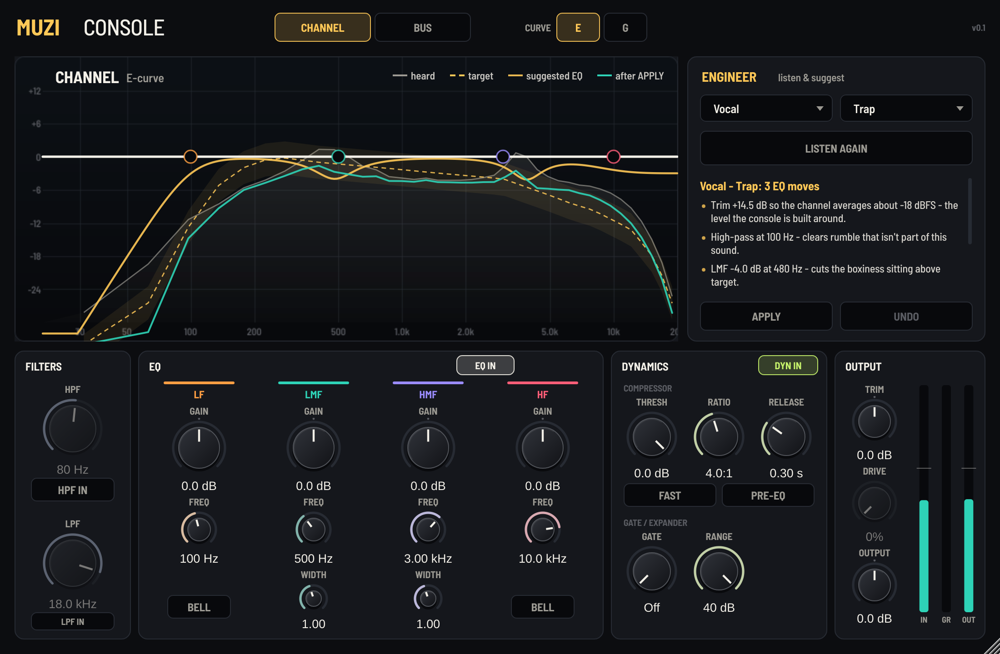
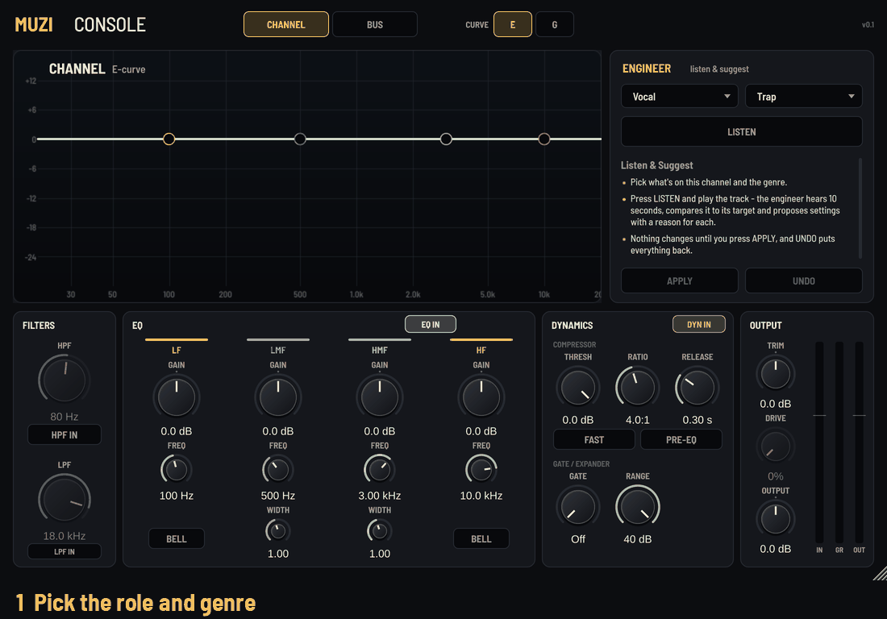
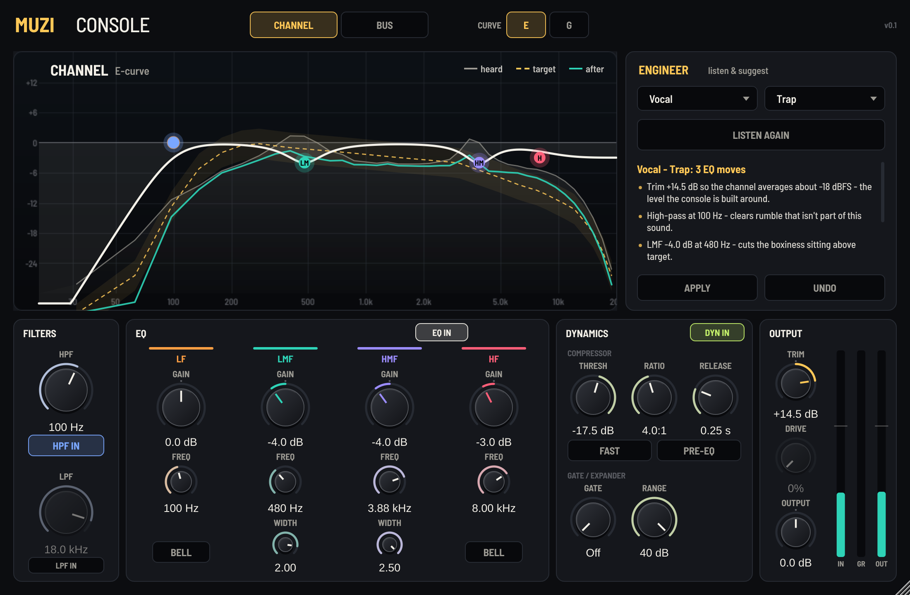
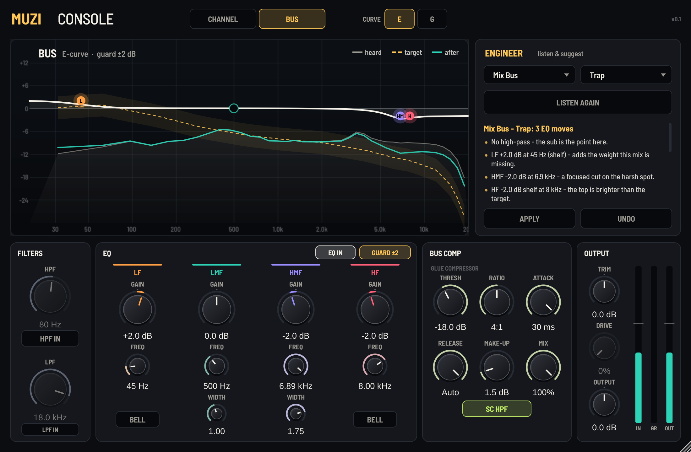

# Muzi Console v0.1

**Manual:** [illustrated PDF](docs/Muzi-Console-v0.1-Manual.pdf) · [quick text version](docs/MANUAL.md) · [annotated panel tour](docs/panel-tour-annotated.png)

| Channel mode, after APPLY | Bus mode on a mix |
| --- | --- |
|  |  |

A console strip with a listening engineer. One plugin, two jobs:

- **CHANNEL**: for one track. Trim, high/low-pass filters, a four-band console EQ, compressor, gate/expander and drive.
- **BUS**: for groups and the mix. The same EQ held to gentle moves (±2 dB guard), plus a glue compressor with mix and sidechain high-pass.

The EQ has two curve flavours. They're inspired by the classic British console EQs, not copies of any unit:

- **E**: bell width stays the same at any gain. Gentle shelves.
- **G**: bells narrow as you boost (proportional Q), so small moves are broad and big moves are focused. Shelves are steeper, with a small opposite dip just inside the turnover.

## Open it (the usual way)

1. Unzip, then double-click **Muzi-Console.jucer**. JUCE 9.0.5 is already inside, in `JUCE/`.
2. In Projucer, click the Xcode button. The project is already generated in `Builds/MacOSX`, so you can also open `Muzi Console.xcodeproj` directly.
3. Build. Debug and Release are both optimised (-O3), so the Debug build you get from Xcode's Run button won't stutter on the Intel Mac.
4. You get VST3, AU and a Standalone app. The build copies the plugins into `~/Library/Audio/Plug-Ins`.

Alternatively, with CMake: `cmake -S . -B build -G Xcode && cmake --build build --config Release`.

## Listen & Suggest

1. Pick what's on the channel (Vocal, Kick, 808/Sub, Bass, Snare/Clap, Hats, Guitar, Keys/Synth, Sample/Loop, Mix Bus) and a genre (Neutral, Trap, Drill, R&B, Boom Bap, Pop).
2. Press **LISTEN** and play the busiest part of the song. It stops by itself after 10 seconds of sound, or you can press STOP.
3. The display shows what it heard (grey), the target with a ±3 dB tolerance tube (gold dashes), the suggested EQ (solid gold) and the predicted result (teal). Each move comes with a reason in the panel.
4. Press **APPLY** to set it. **UNDO** puts every control back. Change the role or genre afterwards and it re-suggests from the same listen, so there's no need to listen again.

How it decides:

- **Measurement**: averaged over the loud part of the audio, on critical bands (one band per ERB, about 40 from 20 Hz to 20 kHz). Silence and quiet tails are ignored.
- **Targets**: one per role, shifted by genre. Trap and Drill add sub, Drill is darker on top, R&B gets a glossier top, Boom Bap has dustier highs, Pop gets more presence. These are starting points from common practice, not copies of any record.
- **Cuts first**:
  - Mud and boxiness (LMF) and harshness (HMF) are found two ways: excess over the target, and resonances that stick up above their own octave neighbourhood.
  - Each problem's width is measured by fitting a bell to it, and the suggested Q is set from that fit (through the E/G law).
  - Boosts (body, presence, air, low weight) only happen where the role wants them and the source is clearly short of the target.
- **Restraint**: anything within 3 dB of the target (2 dB on a bus) is left alone.
- **Bus rule**:
  - Bus EQ moves are held to ±2 dB. If the mix wants more than that, the engineer says so and names the likely channel to fix it on.
  - It never trims or high-passes a bus by default. The exception is sub-sonic junk below about 25 Hz.
- **Gain staging**: channel trim brings the average to about -18 dBFS.
- **Compressor**: the threshold is solved from the measured peaks so the ratio lands near a gain-reduction goal for the role. That's about 5 dB on a vocal and 2 dB of glue on a bus.
- **808 in Trap/Drill**: 35% drive, for harmonics that read on phone speakers.

## Notes

- Zero latency, no oversampling. The drive is gentle by design.
- The engineer runs on its own thread, never in the audio callback.
- The display redraws only when something changes. The meters are a separate small area, so the panel stays light on an Intel Mac.
- Parameter IDs are fixed from v0.1, so saved sessions will keep loading in later versions.
- The window resizes from 75% to 200% and keeps its proportions.

## Tests (run here before delivery)

- Engine and engineer: 43 checks, all passing (`Tests/EngineTests.cpp`, no JUCE needed). They cover:
  - EQ curve laws, filter slopes and the bus guard
  - compressor/gate/drive levels, nulling when flat, and staying finite under abuse
  - Listen & Suggest finding planted problems, closed-loop improvement, restraint on clean sources and the bus diagnostics
- Speed: one minute of stereo audio with everything on and a sweeping EQ renders in about 0.36 s, roughly 165× real time.
- pluginval strictness 8, at 44.1, 48 and 96 kHz and block sizes 64, 512 and 1024: SUCCESS (Linux build).
- Full panel repaint: about 8 ms, software-rendered.
