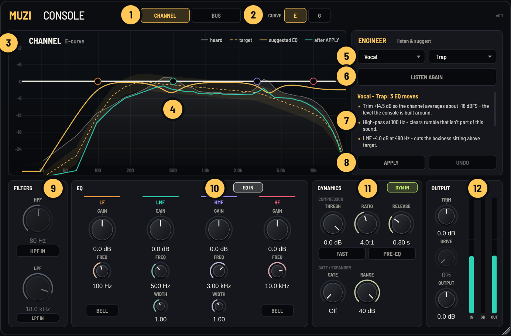

# Muzi Console v0.1: User Manual

> The full illustrated manual is **[Muzi-Console-v0.1-Manual.pdf](Muzi-Console-v0.1-Manual.pdf)**. It has the annotated panel tour, signal-flow diagrams, E/G curve plots computed from the plugin's own EQ, and recipes. This page is the quick text version.

Muzi Console is a channel strip you can put on every track, and on your buses and master. It also has an engineer built in. The engineer listens to the track, compares it with a target for that kind of sound, and suggests settings with a reason for each move. Nothing changes until you press **APPLY**, and **UNDO** puts everything back.

## Quick start

1. Put Muzi Console on a vocal and leave it in **CHANNEL** mode.
2. Pick **Vocal** and your genre in the engineer panel.
3. Press **LISTEN** and play the busiest part of the song. It listens until it has heard 10 seconds of sound (silence doesn't count). Press STOP to finish early; it needs at least 2 seconds.
4. Read the moves. On the display, gold solid is the suggested EQ and teal is the predicted result.
5. Press **APPLY**. Compare with bypass at the same loudness, then adjust by ear.

The engineer gives you a starting point, not a verdict. If a move sounds wrong for your song, it is wrong.

## Channel and Bus

| | Signal flow | Use it for |
| --- | --- | --- |
| **CHANNEL** | Trim > HPF/LPF > [compressor + gate if PRE-EQ] > EQ > compressor + gate > Drive > Output | Single sources: vocals, kick, 808, snare, samples |
| **BUS** | Trim > HPF/LPF > EQ (guarded to ±2 dB) > glue compressor > Drive > Output | Drum and music buses, the master |

**The ±2 dB bus rule.** If a mix needs a bigger EQ move than 2 dB, the problem usually belongs to one track. In BUS mode the engineer holds its moves to 2 dB, says how much the mix really wanted, and names the likely channel to fix it on. For example: *"Around 45 Hz the mix wants +6.0 dB - too much for a bus. Fix it at the source: likely the 808 or kick."* You can switch **GUARD ±2** off to make bigger moves yourself.

## E and G curves

The two curves are inspired by classic British console EQs, not copies of any unit. Switching keeps every knob where it is and changes only the shapes.

- **E**: bells keep the same width at every gain (width factor 0.85). Shelves are smooth and gentle.
- **G**: bells narrow as you boost or cut (proportional Q). The width factor is 0.66 at 3 dB, 0.87 at 6 dB, 1.29 at 12 dB and 1.50 at 15 dB. Small moves are broad and big moves are focused. Shelves are steeper, with a dip of about 0.5 dB just inside the turnover.

## The display

| You see | It means |
| --- | --- |
| White curve | The EQ running now |
| Grey area (heard) | What the engineer heard, in 40 critical bands |
| Dashed gold + tube (target) | The target for the role and genre, with a ±3 dB tolerance |
| Solid gold (suggested EQ) | The proposed EQ, shown until you press APPLY |
| Teal (after) | The predicted result |
| L / LM / HM / H nodes | The four bands. Drag to set frequency and gain, scroll on LM/HM to set width, double-click to reset gain |

## Controls

| Control | Range (default) | Notes |
| --- | --- | --- |
| TRIM | ±24 dB (0) | Aim for about -18 dBFS average (the tick on the IN meter) |
| HPF | 16-350 Hz (80 Hz, out) | 18 dB/octave |
| LPF | 3-22 kHz (18 kHz, out) | 12 dB/octave |
| LF | ±15 dB, 30-450 Hz (100 Hz) | Shelf, or a bell with BELL lit |
| LMF | ±15 dB, 200 Hz-2.5 kHz (500 Hz), width 0.5-2.5 (1.0) | Mud and boxiness |
| HMF | ±15 dB, 600 Hz-7 kHz (3 kHz), width 0.5-2.5 (1.0) | Presence and harshness |
| HF | ±15 dB, 1.5-16 kHz (10 kHz) | Shelf, or a bell with BELL lit |
| DRIVE | 0-100% (0) | Gentle 2nd and 3rd harmonics, level-matched |
| OUTPUT | ±24 dB (0) | Final level |

**Channel dynamics.**
- THRESH -40 to 0 dB.
- RATIO 1:1 to 20:1 (default 4:1).
- RELEASE 0.1-4 s (default 0.3 s).
- Attack is 3 ms, or 0.3 ms with FAST.
- Soft 6 dB knee, with automatic make-up gain.
- GATE -80 (Off) to 0 dB, RANGE 0-40 dB. The gate opens in 0.5 ms, closes over 150 ms, and has 4 dB of hysteresis.
- PRE-EQ puts the dynamics before the EQ.

**Bus compressor.**
- THRESH -30 to 0 dB.
- RATIO 2:1, 4:1 or 10:1.
- ATTACK 0.1-30 ms.
- RELEASE 0.1-1.2 s or Auto (program-dependent).
- MAKE-UP 0-15 dB.
- MIX 0-100% for parallel compression.
- SC HPF stops the compressor reacting below 60 Hz, so the sub doesn't make the mix pump.

## How the engineer decides

1. **Listen**: it hears the raw track (before TRIM) on its own thread. Only the loud, musical part counts.
2. **Measure like an ear**: the spectrum is grouped into 40 critical bands (ERB), levelled per octave.
3. **Compare**: your track is lined up with the role and genre target on the bands that matter for that role.
4. **Cuts first**: mud, boxiness and harshness are found as excess over the target, or as resonances that stick up above their own octave neighbourhood. A bell is fitted to each problem, so the suggested width matches it.
5. **Boosts, sparingly**: only where the role wants them and the track is clearly short of the target.
6. **Restraint**: anything within 3 dB of the target (2 dB on a bus) is left alone. It cuts 75% of an excess (up to 9 dB) and boosts 60% of a shortfall (up to 6 dB).
7. **Gain and dynamics**:
   - Trim to about -18 dBFS average (channel only).
   - The compressor threshold is solved from your track's measured peaks to hit a gain-reduction goal: about 5 dB on vocals, 3 dB on kicks.
   - The bus gets about 2 dB of glue: 4:1 for Trap, Drill and Boom Bap, otherwise 2:1, with 30 ms attack and Auto release.

| Role | High-pass | Adds | Compressor |
| --- | --- | --- | --- |
| Vocal | 80 Hz (100 Hz in Trap/Drill) | Body 220 Hz if thin, presence 2.8 kHz (1.5 kHz in Pop), air | 4:1, ~5 dB |
| Kick | 25 Hz | Low bell 60 Hz (55 Hz in Trap/Drill), click 3.5 kHz | 4:1, ~3 dB |
| 808 / Sub | none | Low shelf 60 Hz; 35% drive in Trap/Drill | 3:1, ~3 dB |
| Bass | 30 Hz | Low shelf 90 Hz, definition 800 Hz | 4:1, ~4 dB |
| Snare / Clap | 80 Hz | Body, crack 4 kHz, air | 4:1, ~4 dB |
| Hats / Cymbals | 400 Hz | Air only | 2:1, ~2 dB, fast |
| Guitar | 90 Hz | Body, presence 3 kHz, air | 3:1, ~3 dB |
| Keys / Synth | 100 Hz | Presence 2.5 kHz, air | 2:1, ~2 dB |
| Sample / Loop | 40 Hz | Low shelf 70 Hz, air | 2:1, ~2 dB |
| Mix Bus | 20 Hz only if sub-sonic junk | Low shelf 45 Hz, air (±2 dB) | Bus glue ~2 dB |

**Genres:**
- **Trap**: more sub on low sources, extra air.
- **Drill**: the same sub, with a darker top.
- **R&B**: a glossier top and a cleaner 250-500 Hz.
- **Boom Bap**: warmer low-mids and dustier highs.
- **Pop**: more 1-3 kHz presence.

These targets are starting points drawn from common practice, not measurements of any record.

## Tips

- Compare with bypass at the same loudness, using OUTPUT. Louder always sounds better at first.
- LISTEN to the busiest part of the song, not the intro.
- Change role or genre after a listen to see how the suggestion changes. There's no need to listen again.
- If a bus note says "fix it at the source", put a second Muzi Console on that channel and LISTEN there.
- 808 not audible on a phone? Use 808 / Sub + Trap: the drive adds harmonics an octave up that small speakers can play.
